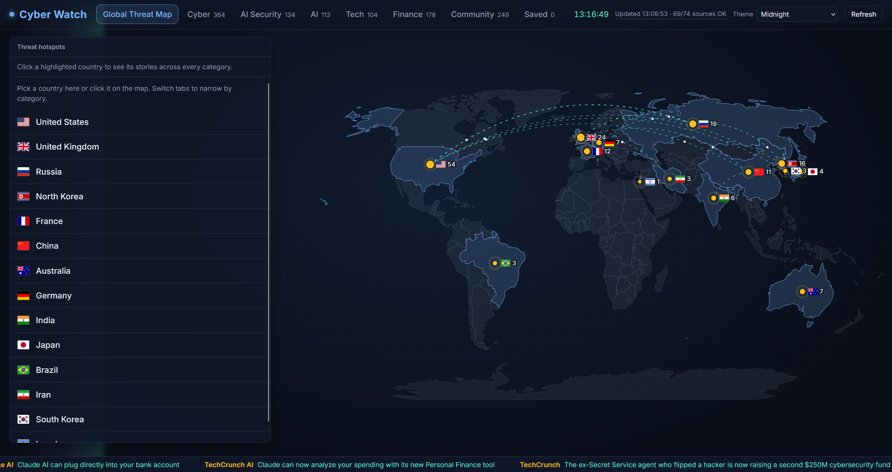
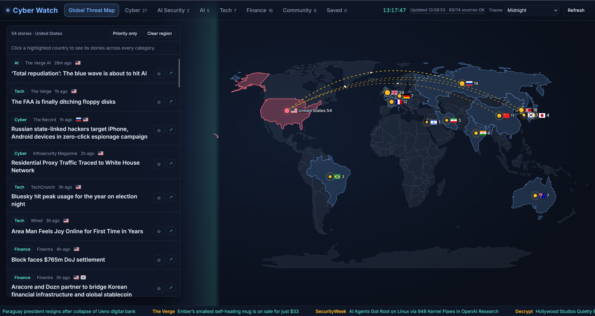
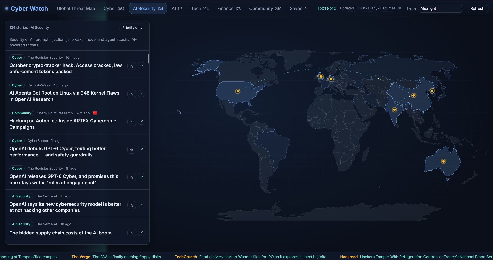
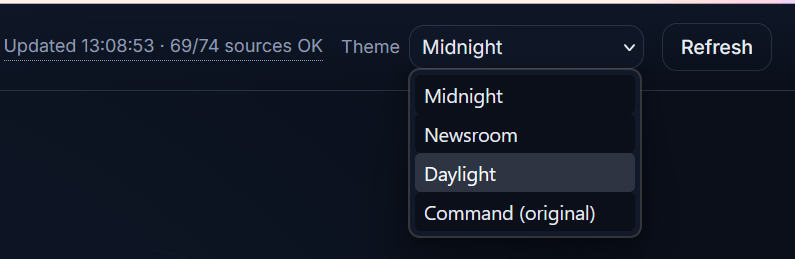

# Cyber Watch
**Live demo:** https://cyber-watch-8z2p.onrender.com
**All the cyber news I follow, on one live page.**

Keeping up with cybersecurity used to mean opening a dozen sites every day: CISA, BleepingComputer, Krebs,
The Hacker News, vendor research blogs, and more. I built Cyber Watch so that happens in one place. It pulls
headlines from 74 official and trusted sources, keeps them up to date, sorts them by topic and country, and
lets me read the stories without leaving the page.



## Why I built it

I wanted a single dashboard I could check in the morning and trust to be current. The problems I was solving:

- **Too many tabs.** News is spread across agencies, news sites, researchers and vendors.
- **No sense of where things are happening.** A map makes it obvious which countries are in the news.
- **Urgent items get buried.** An actively exploited bug looks the same as a product announcement in most
  feeds. Here it is flagged.

## What it does

### See the world at a glance

The home view is an animated map of 14 focus countries: the United States, United Kingdom, Russia, North
Korea, France, China, Australia, Germany, India, Japan, Brazil, Iran, South Korea and Israel. Pins pulse where
stories are, and glowing arcs connect countries that show up in the same story. The country list on the left
is ranked by activity.

### Filter by country and topic

Click a country on the map or in the list, then switch tabs to narrow it down. Here it is the United States
plus Cyber, with the country highlighted on the map.



Tabs: **Global Threat Map, Cyber, AI Security, AI, Tech, Finance, Community** (research, bug bounty,
hacktivism, workforce), plus **Saved** for stories you want to keep.

### Spot urgent stories fast

Stories get a red stripe and badge when they mention active exploitation, KEV entries or zero-days. Critical
flaws, ransomware and breaches get amber. CVE ids link straight to the NVD entry. **Priority only** hides
everything else.

### Read without leaving

Open a story in the built-in reader next to the map, or jump to the original site. Star anything to read later.
Saved stories live in your own browser, so they stay private.



### Pick a look

Four themes: Midnight, Newsroom, Daylight and Command (the original green terminal style).



## Features

- 74 sources. The server refreshes itself every 10 minutes in the background, so the page is already current
  when you open it. Stories older than 14 days are hidden.
- Automatic retries for timeouts, rate limits and server errors
- Source health panel showing which feeds worked and why any failed
- Country tagging by keyword, including threat actor names (Lazarus maps to North Korea, Volt Typhoon to China)
- Keyword categories, so one story can land in several tabs (a prompt injection bug appears in both Cyber and
  AI Security)
- No external requests from the browser. Fonts, flags and libraries are bundled.

## Run it

You need Python 3.10 or newer.

```bash
git clone https://github.com/abdoulsaw5/cyber-watch.git
cd cyber-watch
pip install -r requirements.txt
python app.py
```

Open the address the terminal prints (for example http://127.0.0.1:5050). If a port is blocked, the app tries
others. To force one, set `PORT`, for example `PORT=8123 python app.py` (Mac/Linux), `$env:PORT=8123`
(PowerShell) or `set PORT=8123` (cmd).

## How it works

```
feeds.py   source list, keyword rules, country list, severity rules
app.py     Flask server: fetches feeds, classifies stories, serves the API and the reader
static/    plain JavaScript front end, d3 map, themes, bundled fonts and flags
```

1. A background timer fetches feeds in parallel (6 at a time) every 10 minutes and caches them in memory. A
   refresh has a 4 minute limit, so one source that never answers cannot freeze it.
2. Each feed has a main category. Keyword rules add more.
3. `assess()` scores each story for severity and extracts CVE ids. `detect_countries()` tags countries by
   earliest mention.
4. The front end draws the map and feed from `/api/news`.

| Route | Purpose |
| --- | --- |
| `GET /api/news` | Stories, tab labels, country list, source health (compressed, cached for 2 seconds) |
| `GET /healthz` | Health check for the host: story count and last update time |
| `POST /api/refresh` | Force a refresh |
| `GET /api/article/<id>` | Readable text for a story that is in the feed cache |

## Customize

- **Add a source:** add an RSS or Atom URL to `FEEDS` in `feeds.py`. Optional keys: `"official": True` and
  `"limit": N`.
- **Tune categories and severity:** edit the keyword lists and `SEVERITY_RULES` in `feeds.py`.
- **Add a country:** add an entry to `COUNTRIES` with its numeric ISO code, map position, keywords and flag
  name, and drop the SVG into `static/flags/`.
- **Add a theme:** copy a block of CSS variables at the top of `static/style.css`.

## Security design

- The article reader only fetches URLs that came from the app's own feed cache, so it cannot be used as an open
  proxy (SSRF protection).
- Article text is returned as plain paragraphs and rendered with `textContent`, so a hostile page cannot inject
  script. Feed links are limited to http and https.
- Strict Content-Security-Policy (`default-src 'self'`) and no inline scripts.
- Saved stories are validated when read back, so tampered browser storage cannot inject markup.
- The reader checks every redirect and refuses any address that points to a private or internal network.
- Rate limits on the news, article and refresh routes, a cooldown on refresh, and a cap on simultaneous
  article downloads.
- HSTS forces HTTPS on the live site, and feed downloads and article pages are size capped.
- The server binds to localhost by default.

## Limits

- Classification is keyword based. It will miss some stories and mislabel a few.
- A few sources block automated readers (HTTP 403) or rate limit them (429). The health panel shows which.
- LinkedIn and X do not allow free feed access, so those accounts are not used. Official agency websites
  publish the same alerts over RSS.
- The reader shows full article text. For a public deployment, consider showing only the headline and summary
  and linking out.

## Deploying it

`python app.py` is a development server. For a public site, use a production server behind HTTPS. On Render,
for example:

- Build command: `pip install -r requirements.txt`
- Start command: `gunicorn app:app --bind 0.0.0.0:$PORT --workers 1 --threads 4 --timeout 120`

Keep one worker, because the feed cache lives in memory. Set the health check path to `/healthz`. Optional
settings: `REFRESH_SECS` (how often the server refreshes, default 600) and `MAX_AGE_DAYS` (default 14).


## Updates

| Date | Update |
| --- | --- |
| Nov 5, 2026 | First public release. Repo published on GitHub and deployed live on Render. |
| Nov 7, 2026 | Upgraded the Render compute plan so the site stays running with no sleep or boot-up downtime, and gets more CPU. |
| Nov 13, 2026 | The server now refreshes itself every 10 minutes in the background, so the page is current when you open it, even after days away. |
| Nov 13, 2026 | Added rate limits on the news, article and refresh routes to protect the server from heavy or abusive traffic. |
| Nov 13, 2026 | The article reader now checks every redirect and blocks private network addresses. |
| Nov 13, 2026 | Added a `/healthz` health check, HSTS, compressed and briefly cached news responses, and pinned dependency versions. |
| Nov 13, 2026 | A refresh now has a 4 minute time limit, and progress is written to the server logs. |
| Nov 13, 2026 | Stories older than 14 days are no longer shown. |
| Nov 13, 2026 | Fixed the server running out of memory by capping feed and article download sizes and limiting parallel work. |

## Next features

### In progress

- **Watching memory use.** Checking the Render memory graph after today's fixes to confirm it stays well under
  the 512 MB limit.

### Planned

- **Search** across all stories.
- **Better classification.** Measure the keyword rules against hand-labeled stories and try a stronger
  classifier.
- **More countries** and a per-country detail view.
- **Fix or replace** the few sources that block automated readers.
- **Custom domain** for the live site.
- **Ambient music** with a mute button.

## Credits

Map data from [world-atlas](https://github.com/topojson/world-atlas). Built with Flask, feedparser,
readability-lxml, d3 and topojson. Flags from [flag-icons](https://github.com/lipis/flag-icons) (MIT). Fonts are
Inter and Source Serif 4 (SIL Open Font License). All headlines and article text belong to their original
publishers.

Built by [abdoulsaw5](https://github.com/abdoulsaw5).
